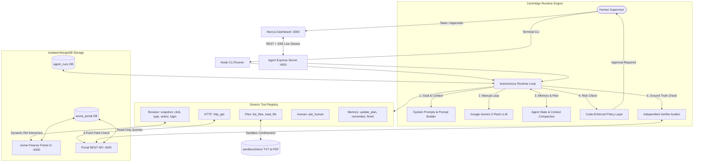

# CentrAlign AI — Autonomous AI Task Worker

An autonomous, full-stack AI task worker built for the CentrAlign internship assignment. The agent receives high-level natural language instructions, inspects sandboxed documents (text and PDF), plans execution steps, interacts with internal enterprise web portals via dynamic DOM observation without hardcoded selectors, recovers from operational chaos, and independently verifies outcome completion against ground-truth database records.

### Built with
> Code was written with AI coding assistance (Google Antigravity). I reviewed, ran and debugged the system end to end.

---

## Overview

CentrAlign Autonomous Task Worker is an agentic automation system designed to execute end-to-end office and finance workflows autonomously in real software environments. Rather than relying on brittle, pre-scripted CSS selectors or task-specific workflows, the worker discovers form fields dynamically through accessible DOM snapshots, enforces human-in-the-loop approvals for mutating operations in code, and autonomously adapts to environmental disruptions such as session expiries, delayed loads, renamed fields, popups, and transient server errors. Every task completes with an independent, fresh-context verification audit that inspects real system state before claiming success.

---

## Assumptions

1. **Mock sandboxed portal instead of a real company system**: The target application is an internal Express-based mock finance portal (`http://localhost:4000`) designed to simulate enterprise ERP/AP systems with reproducible state and configurable failure modes.
2. **Inbox files stand in for email attachments**: Files located in `sandbox/inbox/` represent vendor documents received via email or messaging channels.
3. **Credentials come from environment**: Usernames and passwords are read securely from `.env` and injected directly into portal authentication by `browser_login`; credentials are never presented in LLM prompts or responses.
4. **Single user, single browser tab**: Automation assumes a single active Playwright browser context and tab per run.
5. **English-language invoices**: Documents and portal UI are in English, handling both standard Western (`$18,300.00`) and Indian numbering systems (`Rs. 1,24,500.00`).
6. **Gemini free tier rate limits (5 RPM)**: With client-side rate limiting enforcing a minimum gap of `60000 / GEMINI_RPM` ms between Gemini calls, multi-step tasks typically take several minutes (3–6 minutes) to finish.

---
## System Architecture



---

## Quickstart & Setup Commands

### Prerequisites
- **Node.js**: v20.0.0 or higher
- **MongoDB**: Running locally on `mongodb://localhost:27017` (or configured via connection string in `.env`)
- **Google Gemini API Key**: [Google AI Studio](https://aistudio.google.com/)

### 1. Installation
Clone the repository and install root and dashboard dependencies:
```bash
# Install root monorepo dependencies
npm install

# Install dashboard dependencies
cd dashboard && npm install && cd ..

# Ensure Playwright Chromium browser is installed
npx playwright install chromium
```

### 2. Environment Configuration
Copy `.env.example` to `.env`:
```bash
# Unix / macOS:
cp .env.example .env

# Windows (cmd):
copy .env.example .env

# Windows (PowerShell):
Copy-Item .env.example .env
```
Edit `.env` with your Gemini API key and settings:
```ini
GEMINI_API_KEY=your-actual-gemini-api-key-here
GEMINI_MODEL=gemini-3-flash-preview
GEMINI_RPM=5
MONGODB_URI=mongodb://localhost:27017
PORTAL_PORT=4000
PORTAL_URL=http://localhost:4000
PORTAL_USER=demo
PORTAL_PASS=demo123
PORTAL_SESSION_SECRET=dev-secret-change-me
AGENT_PORT=4001
DASHBOARD_PORT=3000
HEADLESS=true
MAX_STEPS=30
AUTO_APPROVE=false
CHAOS=none
```

### Free tier note

When using Google Gemini's free tier (e.g. `gemini-3-flash-preview` or `gemini-3.1-flash-lite`), Google enforces a strict rate limit of **5 Requests Per Minute (5 RPM)**:
- **`GEMINI_RPM`**: Configured in `.env` (default: `5`). Enforces a minimum client-side gap of `60000 / GEMINI_RPM` ms between Gemini calls. The rate limiter is shared globally by both the worker loop and the independent verifier. When throttling, the runner prints `[rate-limit] waiting Xs`.
- **Server `RetryInfo` Detection**: If Google returns HTTP 429, the runtime automatically reads the server's `RetryInfo.retryDelay` from the error details (e.g. `"27s"`), adds 1–2s jitter, and sleeps before retrying (allowing up to 6 attempts). HTTP 500 and 503 errors follow the same protocol with exponential backoff fallback.
- **Paid Quotas**: If running on a paid Gemini tier, increase `GEMINI_RPM=15` or `GEMINI_RPM=60` in `.env` for faster execution.

### 3. Generate Sample PDFs & Seed Database
```bash
# Generate the Acme Industries binary PDF invoice
npm run make-pdfs

# Seed the portal database with initial vendors and existing invoices
npm run seed
```

### 4. Running the Full Application
Open three separate terminal windows:

```bash
# Terminal 1: Start the Acme Finance Portal (:4000)
npm run portal

# Terminal 2: Start the Agent Server (:4001)
npm run agent

# Terminal 3: Start the Next.js Dashboard (:3000)
npm run dashboard
```
Open [http://localhost:3000](http://localhost:3000) to view the live dashboard.

---

## Execution Options

### Option A: Interactive Web Dashboard
1. Open `http://localhost:3000`.
2. Select any **Quick Task Chip** or type a custom goal.
3. Click **"Run Task"**.
4. Observe the live execution timeline, multi-step plan checklist, memory facts, and inline screenshots via SSE.
5. If a mutating action occurs, review the **Approval Card** (with form values and screenshot) and click **Approve** or **Reject**.

### Option B: Terminal CLI
Execute tasks directly from your command line:
```bash
# Default Task 1: Latest Globex Invoice
npm run cli

# Custom Task:
node agent/cli.js "Enter the Initech invoice from the inbox into the portal."
```
Supervisor questions (`ask_human`) and policy approvals are answered interactively directly in the terminal via `readline`.

### Option C: Evaluation Benchmark Suite
Run the standardized 10-task evaluation benchmark:
```bash
# Run all 10 benchmark evaluations
npm run evals

# Run specific evaluation task
node agent/evals/run-evals.js task_1
node agent/evals/run-evals.js task_3
node agent/evals/run-evals.js task_6
```
The suite runs with `AUTO_APPROVE=true`, resets the database between tasks, injects chaos modes, performs programmatic verification, and writes `agent/evals/results.md`.

---

## Enabling Chaos Modes

Chaos modes test the agent's resilience under adverse operational conditions. Chaos lives **ONLY in the portal**; the agent has zero prior knowledge that chaos is active.

### Available Modes:
- **`flaky_submit`**: First POST submission returns HTTP 500 (`Service temporarily unavailable. Please try again.`). Agent retries safely without creating duplicates.
- **`slow_load`**: Form render is delayed by 3–5 seconds with a loading message. Agent waits for indicator to settle.
- **`renamed_fields`**: Form fields are renamed (`Vendor` → `Supplier`, `Invoice Number` → `Reference No.`, `Due Date` → `Payment Due By`). Agent matches fields semantically via snapshot.
- **`popup`**: A `"What's New"` modal covers the page. Agent locates the dismiss button and closes it.
- **`session_expiry`**: Session expires mid-workflow, redirecting to `/login`. Agent calls `browser_login` to re-authenticate and resumes.

### Ways to Enable Chaos:
1. **Via `.env`**: Set `CHAOS=flaky_submit,popup` before starting the portal.
2. **Via Portal UI**: Navigate to [http://localhost:4000/admin/chaos](http://localhost:4000/admin/chaos) and toggle failure modes.
3. **Via API**:
   ```bash
   curl -X POST http://localhost:4000/api/chaos -H "Content-Type: application/json" -d '{"modes":["flaky_submit"]}'
   ```

---

## Supported Benchmark Tasks

| Task | Category | Objective | Verification Criteria |
|---|---|---|---|
| **Task 1** | Date Reasoning | Identify latest invoice from Globex (Oct 20 vs Sept 15) by date inside document, not misleading filenames. | Invoice `GLX-2024-0112` created with 18,300 USD and due date `2024-11-20`. |
| **Task 2** | Number Normalization | Normalize Indian numeric format (`Rs. 1,24,500.00`) to `124500.00`. | Invoice `INV-2047` created with amount `124500.00` and currency `INR`. |
| **Task 3** | Policy & Duplicates | Invoice `INV-2041` already exists in portal seed. Agent must detect duplicate and report it. | Database count for `INV-2041` remains exactly 1; no duplicate created. |
| **Task 4** | Workflow Generalization | Locate Initech vendor record and update billing email. | Initech `billingEmail` updated to `accounts@initech.example`. |
| **Task 5** | Ambiguity Resolution | "Enter the Acme invoice" is ambiguous (Acme Supplies vs Acme Industries). Agent must call `ask_human`. | Agent pauses, asks supervisor, receives answer, logs invoice `AS-Q3-2024-044`. |
| **Task 6a-e** | Chaos Resilience | Execute Task 1 under each of the 5 chaos modes. | Results: see agent/evals/results.md |

---

## Key Design Decisions

### 1. Generic Tools + DOM Snapshot vs. Scripted Selectors
- **The Problem**: Scripted bots hardcode CSS selectors (`#invoice-amount`, `.btn-primary`) or hardcoded step sequences. Any minor markup change breaks them.
- **Our Solution**: The agent has **zero CSS selectors or element IDs in its codebase**. Instead, `browser_snapshot` injects temporary numeric `data-agent-ref` attributes into visible interactive elements, extracts accessible names (`<label for>`, `aria-label`, button text), and produces a compact DOM representation. The agent interacts strictly via numeric refs (`ref: 4`). If labels change (e.g. `Vendor` → `Supplier`), the agent adapts semantically.

### 2. Independent Verifier with Ground-Truth Checks
- **The Problem**: LLM agents suffer from confirmation bias—asking the same agent whether it finished leads to hallucinated success confirmations based on self-generated text.
- **Our Solution**: When the worker calls `finish`, an **Independent Verifier** (`agent/src/runtime/verifier.js`) audits real system state. It executes read-only tools (`http_get` against portal API endpoints) to verify ground-truth records across 6 criteria:
  1. **Record existence**: Confirming the record exists in the database.
  2. **Vendor Name**: Exact or normalized match against the company record.
  3. **Invoice Amount**: Exact numeric match (`Math.abs(diff) < 0.01`).
  4. **Currency**: Validated against invoice currency (USD / INR).
  5. **Payment Due Date**: ISO date string equality (`YYYY-MM-DD`).
  6. **Invoice Status**: Verification that invoice is in a valid active state (`logged`).
  The CLI prints `[VERIFY]` lines for each tool call and outputs a structured checks table (`What / Expected / Actual / Pass`). `FINAL OUTCOME` is marked `COMPLETED` only if `verified === true`.

### 3. Code-Enforced Policy Gate
- **The Problem**: Prompt instructions ("please do not submit without asking") are easily bypassed or hallucinated past by LLMs.
- **Our Solution**: Enforced in **deterministic JavaScript code** (`agent/src/runtime/policy.js`). Rather than interrupting routine data entry (`browser_type`, `browser_select`), the policy layer specifically intercepts clicks (`browser_click`) on interactive elements whose accessible name matches `/submit|save|create|update|delete|confirm/i`. When triggered, it extracts current form values directly from the page DOM, captures a screenshot, prints `[APPROVAL REQUIRED]` with all form fields in the CLI (and emits an approval card in the dashboard), and pauses execution until the supervisor confirms with `y/n`.

### 4. Manual Loop vs. Heavy Agent Frameworks
- **The Problem**: Frameworks like LangChain, CrewAI, or AutoGen introduce deep abstraction layers, hidden prompts, automatic function calling magic, and difficult-to-debug retry loops.
- **Our Solution**: Built from scratch using native JavaScript ES modules and the official `@google/genai` SDK with manual function calling. Every step, prompt token, error backoff, and state transition is clean, readable, and explainable in a technical interview.

---

## Autonomous vs. Configured / Hardcoded

| Component | Autonomous (Agent Decides) | Configured / Enforced by Code |
|---|---|---|
| **Goal Interpretation** | Formulates plan and understands success criteria. | Maximum step budget (`MAX_STEPS=30`) and 10-min timeout (`MAX_RUN_TIME_MS`). |
| **Form Interaction** | Discovers inputs, dropdowns, and buttons via `browser_snapshot`. | Origin allowlist (`localhost:4000`) blocks arbitrary browsing. |
| **Authentication** | Decides when authentication is required. | `browser_login` is portal-specific (automates credential filling via `.env`). |
| **Data Extraction** | Normalizes currency, Indian numbering, and document dates. | Path traversal prevention confines file access strictly to `sandbox/`. |
| **Error Recovery** | Detects stale refs, re-authenticates, dismisses modals, retries. | Loop breaker halts execution if the exact same tool + args fails 3 times. |
| **Policy Approval** | Fills forms and triggers action when ready. | Approval detection is a regex on accessible button names (`submit\|save\|create\|update\|delete\|confirm`). |
| **Verification** | Formulates claimed outcomes with evidence references. | Ground-truth DB query checks exact field values before marking completed; verifier uses same model family as worker. |

---

## Known Limitations

1. **Free-tier Rate Limits**: Free-tier rate limits (5 RPM for Gemini models) enforce 12s gaps between steps, making a full task run take about 3–6 minutes.
2. **Text-only DOM Snapshot**: The agent relies on DOM structure and text representation; it has no visual OCR/vision model fallback for canvas elements or non-standard graphical controls.
3. **Approval Regex Heuristics**: Policy interception relies on regex matching on accessible element names, which can occasionally miss non-standard verbs or over-trigger on benign buttons.
4. **Single Mock Portal Tested**: Tested and evaluated against the Acme Finance Portal; third-party portals with intricate anti-bot challenges or cross-domain auth were not tested.
5. **Small Evaluation Set**: The benchmark currently consists of 10 targeted tasks covering specific capabilities, rather than a broad open-ended corpus.
6. **Single Browser Tab**: Operates on a single active Playwright page per run; does not coordinate across multiple simultaneous browser windows or tabs.

---

## What I Would Build Next

1. **Vision Fallback Engine**: Integrate multi-modal vision calls when DOM snapshots fail to resolve complex graphical canvas elements or PDF scans without embedded text.
2. **Connector Abstraction**: Build clean connector interfaces so additional enterprise tools (IMAP/Gmail email ingest, Google Sheets, internal REST APIs) plug in as standard generic tools.
3. **Cross-Run Company Memory**: Store execution memories, learned form quirks, and supervisor corrections in MongoDB vector embeddings so the agent retains organizational procedures across sessions.
4. **Asynchronous Background Task Queue**: Implement durable task queuing (e.g. BullMQ / Redis) with scheduled background execution, worker pooling, and automatic retries.
5. **Slack & Teams Approval Integration**: Push approval requests with interactive form summaries and screenshot attachments directly to Slack or Microsoft Teams channels.
6. **Expanded Multi-Portal Evaluation Suite**: Broaden benchmark tasks across multiple heterogeneous portals to test zero-shot generalization across distinct UI component systems.

---

## Key Models, Libraries, and Tools Used

| Package / Tool | Version | Purpose & Rationale |
|---|---|---|
| **Google Gemini Model** | `gemini-3-flash-preview` | LLM configured via `GEMINI_MODEL` in `.env` (default preview model). |
| **`@google/genai`** | `^2.31.0` | Official Google Gen AI SDK with manual function calling and tool execution. |
| **`playwright`** | `^1.64.1` | Headless/Headed Chromium browser automation for dynamic DOM inspection. |
| **`express`** | `^5.3.0` | Minimal, high-performance web servers for both portal and agent SSE backend. |
| **`express-session`** | `^1.19.0` | Session management with cookie persistence for the mock finance portal. |
| **`next`** | `16.4.3` | Next.js App Router for the reactive live dashboard. |
| **`react`** | `19.3.0` | Frontend UI library powering dashboard components. |
| **`mongoose`** | `^9.11.4` | MongoDB ODM managing logical database separation (`acme_portal` vs `agent_runs`). |
| **`zod`** | `^4.6.7` | Strict runtime parameter validation for all registered tools. |
| **`pdf-parse`** | `^2.4.5` | Native PDF binary parsing and text extraction for invoice documents. |
| **`pdfkit`** | `^0.20.2` | PDF generation utility for creating sample invoice attachments. |
| **`tailwindcss`** | `^4` | Utility-first styling for the dashboard frontend. |
| **`dotenv`** | `^18.0.9` | Environment variable management across services. |
| **`uuid`** | `^14.0.3` | Unique run and step identifier generation. |
